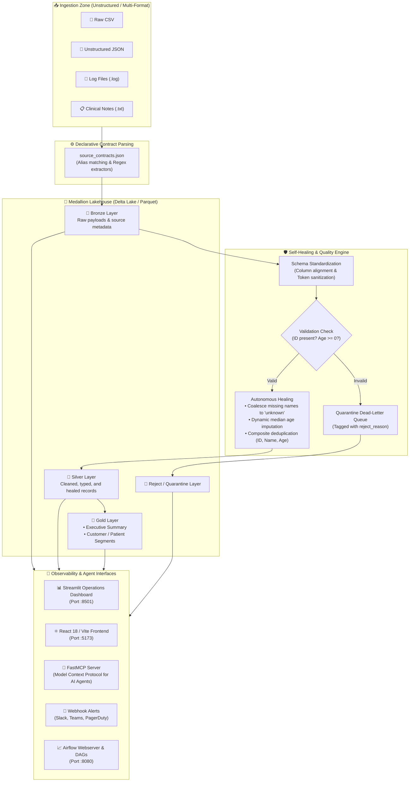
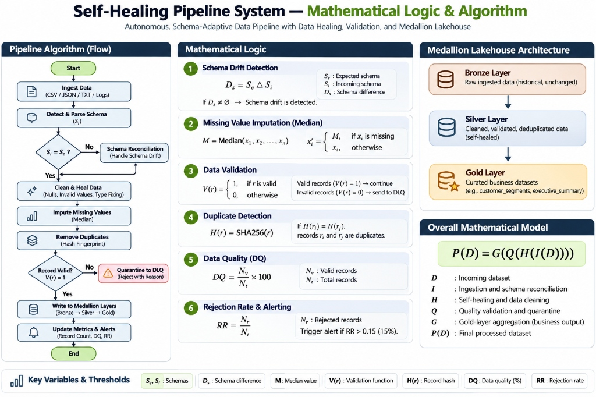
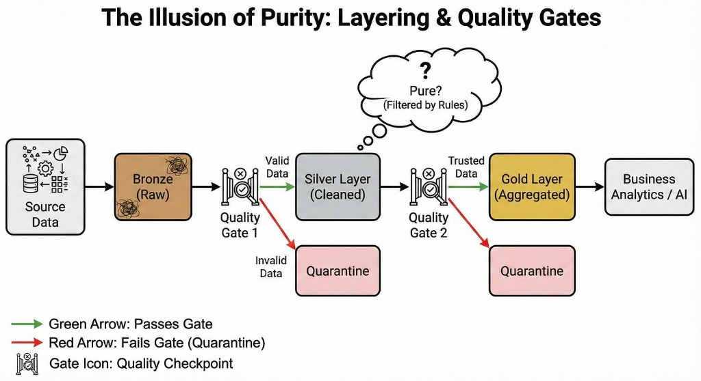

<div align="center">

# 🛡️ Self-Healing Pipeline System Configuration

**Autonomous, Schema-Adaptive Lakehouse Data Pipeline with Delta Lake, PySpark, Apache Airflow, and Model Context Protocol (MCP)**

[](https://opensource.org/licenses/Apache-2.0)
[](https://www.python.org/)
[](https://spark.apache.org/)
[](https://delta.io/)
[](https://airflow.apache.org/)
[](https://modelcontextprotocol.io/)
[](https://streamlit.io/)
[](https://www.docker.com/)
[]()
[](CONTRIBUTING.md)
[](https://github.com/psf/black)

<p align="center">
  <a href="#key-features">Key Features</a> •
  <a href="#architecture--medallion-lakehouse-flow">Architecture</a> •
  <a href="#-mathematical-logic--algorithmic-formulation">Algorithm & Logic</a> •
  <a href="#quickstart-in-60-seconds">Quickstart</a> •
  <a href="#agentic-mcp-integration">Agentic MCP</a> •
  <a href="#configuration-matrix">Configuration</a> •
  <a href="#contributing">Contributing</a>
</p>

</div>

---

## 🌟 Overview

Data pipelines break every day due to schema drift, messy unstructured payloads, missing values, duplicate records, and silent upstream format modifications. **Self-Healing Pipeline System Configuration** eliminates data downtime by introducing an autonomous self-healing data ingestion engine for modern Lakehouses.

Built with **PySpark**, **Delta Lake**, and **Apache Airflow**, this system ingests disparate multi-format sources (CSV, JSON, TXT, and application logs), dynamically parses fields via declarative source contracts, auto-repairs dirty and missing values in-flight, quarantines corrupted records into an isolated dead-letter queue (DLQ), and publishes ACID-guaranteed Medallion layers (Bronze, Silver, Gold).

Pipeline health, lineage, and runtime quality events are continuously exposed through an interactive **Streamlit Control Room** and a **FastMCP (Model Context Protocol)** server, allowing AI assistants (Claude, Gemini, Cursor) to monitor, inspect, and diagnose pipelines in real time.

---

## ✨ Key Features

| Capability | Description |
| :--- | :--- |
| 🛡️ **Autonomous Self-Healing** | In-flight schema reconciliation, null-like token cleansing (`"null"`, `"N/A"`, `"NaN"`, `"undefined"`), regex integer extraction, dynamic median imputation, and automated deduplication. |
| ⚡ **Medallion Architecture** | Strict ACID lakehouse stages: **Bronze** (raw historical record), **Silver** (cleaned & healed), and **Gold** (curated business aggregates like `customer_segments` and `executive_summary`). |
| 🛑 **Quarantine Dead-Letter Queue** | Corrupt and irrecoverable records are automatically quarantined into `data/reject` with explicit failure reasoning (`missing_id`, `negative_age`) without halting the pipeline. |
| 🤖 **AI-Ready FastMCP Server** | Native [Model Context Protocol](https://modelcontextprotocol.io/) server exposing pipeline snapshots, run statuses, active alerts, and customer segments to LLMs and agentic hosts. |
| 🔄 **Dual Airflow Orchestration** | Includes both a scheduled batch DAG (`0 5 * * *`) and an event-driven DAG featuring real-time file-sensing triggers. |
| 📊 **Real-Time Observability** | Interactive Streamlit Control Center dashboard and modern React 18/Vite operations client tracking record throughput, lineage trees, and quality events. |
| 🔒 **Idempotency & Lineage** | Fingerprinted file hashing (name + file size + modification time) prevents redundant batch reprocessing; complete dataset lineage is captured per run. |
| 🚨 **Automated Webhook Alerts** | Real-time Slack/Discord/Teams webhook notifications triggered whenever the batch reject rate exceeds configurable thresholds. |
| 🐳 **One-Click Docker Stack** | Fully orchestrated container environment containing PostgreSQL, Airflow, Spark Runner, Streamlit Dashboard, MCP Server, and Demo Data Simulator. |

---

## 🏗️ Architecture & Medallion Lakehouse Flow



---

## 🧠 Mathematical Logic & Algorithmic Formulation

To deliver autonomous reliability without manual engineering intervention, the pipeline executes a formal mathematical model for data ingestion, dynamic healing, quality gates, and analytical projection:

<p align="center">
  
</p>

### 1. Overall Mathematical Model

The end-to-end transformation of any incoming raw dataset $D$ into high-trust curated analytical outputs $P(D)$ is expressed as a composite function:

$$P(D) = G\Bigl(Q\Bigl(H\Bigl(I(D)\Bigr)\Bigr)\Bigr)$$

Where each operator performs a deterministic stage in the lifecycle:
- **$I(D)$ (Ingestion & Schema Reconciliation)**: Ingests heterogeneous payloads (CSV, JSON, TXT, LOG) and reconciles incoming schema $S_i$ against expected contract $S_e$.
- **$H(\cdot)$ (Self-Healing & Cleansing)**: Sanitizes null tokens, applies dynamic regex type-casting, imputes missing values, and deduplicates records.
- **$Q(\cdot)$ (Quality Gate & Quarantine Validation)**: Evaluates validity function $V(r)$. Isolates irrecoverable records into the Dead-Letter Queue (DLQ).
- **$G(\cdot)$ (Gold-Layer Aggregation)**: Groups cleansed records into executive summaries and segment distributions.
- **$P(D)$**: Final published dataset stored with ACID guarantees in Delta Lake.

---

### 2. Algorithmic Breakdown & Logic Gates

#### ① Schema Drift Detection & Reconciliation
Let $S_e$ be the set of expected attributes and $S_i$ be the set of incoming attributes extracted from the source:
$$D_s = S_e \ \Delta \ S_i = (S_e \setminus S_i) \cup (S_i \setminus S_e)$$

- **Decision Rule**: If $D_s \neq \emptyset$, schema drift is detected.
- **Self-Healing Action**: Missing expected attributes are automatically backfilled with typed null placeholders, and extraneous columns are preserved or realigned via `source_contracts.json`.

#### ② Missing Value Imputation (Dynamic Batch Median)
For numerical fields (e.g., patient/customer age), missing or corrupted tokens are imputed using the batch median $M$:
$$M = \text{Median}(x_1, x_2, \dots, x_n)$$

$$x_i' = \begin{cases} M, & \text{if } x_i \text{ is missing, null, or invalid} \\ x_i, & \text{otherwise} \end{cases}$$

This prevents statistical distortion caused by arbitrary zeroes or default values while maintaining downstream analytical integrity.

#### ③ Data Validation & Quarantine Decision
Each record $r$ is evaluated by a deterministic predicate function $V(r) \in \{0, 1\}$:
$$V(r) = \begin{cases} 1, & \text{if } r.\text{id} \neq \text{null} \ \land \ r.\text{age} \ge 0 \\ 0, & \text{otherwise} \end{cases}$$

- If $V(r) = 1$: The record is certified valid and advances to the **Silver Layer**.
- If $V(r) = 0$: The record fails the quality gate and is diverted to the **Quarantine DLQ** (`data/reject`) with an explicit reason tag (`missing_id`, `negative_age`).

#### ④ Cryptographic Idempotency & Deduplication
To guarantee that batch re-runs and duplicate files do not corrupt target tables, a SHA-256 fingerprint hash $H(r)$ is derived across primary attributes $(r.\text{id}, r.\text{name}, r.\text{age})$:
$$H(r) = \text{SHA256}(r.\text{id} \parallel r.\text{name} \parallel r.\text{age})$$

$$\text{If } H(r_i) = H(r_j) \implies \text{Drop duplicate } r_j$$

#### ⑤ Data Quality (DQ) Score
The batch health index is computed after each execution run:
$$DQ = \left( \frac{N_v}{N_t} \right) \times 100$$
Where $N_v$ is the count of valid records passing the gate, and $N_t$ is the total record volume received.

#### ⑥ Rejection Rate (RR) & Autonomous Alerting
The batch rejection proportion $RR$ determines automated alert dispatch:
$$RR = \frac{N_r}{N_t}$$

$$\text{Trigger Webhook Alert} \iff RR > 0.15 \ (15\%)$$

When $RR > 0.15$, an automated webhook alert (Slack/Discord/Teams) is fired, and a high-severity alert is logged to metadata.

---

### 3. The "Illusion of Purity": Layering & Quality Gates

Modern enterprise pipelines often operate under the false assumption that upstream data arrives in a pristine format. In reality, data purity is an **illusion** that must be rigorously enforced through defensive checkpoints:

<p align="center">
  
</p>

- **Bronze Layer (Raw Ingestion)**: Ingests unfiltered, raw multi-source payloads directly. No assumptions of cleanliness are made.
- **Quality Gate 1 (Structural & Syntax Enforcement)**: Enforces contract matching, sanitizes tokenized null strings (`"null"`, `"N/A"`, `"NaN"`), repairs schema drift, and routes fatal anomalies to Quarantine.
- **Silver Layer (Cleaned & Healed)**: Contains validated, deduplicated, and imputed records ready for operational query workloads.
- **Quality Gate 2 (Business & Relational Integrity)**: Validates segment domain ranges, statistical consistency, and business logic before promoting datasets to Gold.
- **Gold Layer (Curated Aggregates)**: Trusted business-facing datasets (`customer_segments`, `executive_summary`) feeding BI dashboards, machine learning pipelines, and LLM agent contexts.

---

### 4. Key Variables & Mathematical Abbreviations

| Notation / Abbreviation | Full Name | Description |
| :--- | :--- | :--- |
| **$D$** | Raw Input Dataset | Heterogeneous inbound file batch in `data/raw`. |
| **$S_e$** | Expected Schema | Target schema defined in `source_contracts.json`. |
| **$S_i$** | Incoming Schema | Dynamically inferred schema from source file. |
| **$D_s$** | Schema Difference / Drift | Symmetric set difference between expected and incoming schemas ($S_e \ \Delta \ S_i$). |
| **$I(\cdot)$** | Ingestion Operator | Maps file extensions to parsers and extracts structured columns. |
| **$H(\cdot)$** | Self-Healing Operator | Null token cleaning, regex integer extraction, and median imputation. |
| **$Q(\cdot)$** | Quality Gate Operator | Filters records based on validity predicate $V(r)$. |
| **$G(\cdot)$** | Gold Aggregation Operator | Derives business KPIs, age groups, and segment distributions. |
| **$P(D)$** | Processed Dataset Output | Final certified Medallion Lakehouse dataset. |
| **$M$** | Median Imputation Value | Approximate median of valid numerical values calculated dynamically per batch. |
| **$V(r)$** | Validation Predicate Function | Binary indicator function evaluating record validity ($1 = \text{valid}, 0 = \text{reject}$). |
| **$H(r)$** | Hash Fingerprint | SHA-256 / MD5 digest used for deduplication and file idempotency. |
| **$N_v$** | Valid Record Count | Volume of clean records advancing to the Silver layer. |
| **$N_r$** | Rejected Record Count | Volume of anomalous records routed to Quarantine. |
| **$N_t$** | Total Record Count | Total records ingested across the batch ($N_t = N_v + N_r$). |
| **$DQ$** | Data Quality Index (%) | Percentage ratio of valid records relative to total records. |
| **$RR$** | Rejection Rate Ratio | Fraction of records quarantined ($N_r / N_t$). Triggers alert if $> 0.15$. |
| **DLQ** | Dead-Letter Queue | Quarantined storage tier (`data/reject`) holding malformed records with root-cause diagnostic tags. |
| **MCP** | Model Context Protocol | Open standard for exposing pipeline tools and health context to AI models. |

---

## 🚀 Quickstart in 60 Seconds

### Option A: Complete Docker Compose Stack (Recommended)

Start the full stack with Airflow, PostgreSQL, Streamlit, FastMCP, and the continuous demo data generator:

```bash
# 1. Clone repository
git clone https://github.com/Hey-Dhruv-15/Pipeline-System-Configuration.git
cd Pipeline-System

# 2. Copy environment template
cp .env.example .env

# 3. Launch stack
docker compose up -d postgres airflow-init
docker compose up -d airflow-webserver airflow-scheduler dashboard mcp-server

# 4. Trigger one-off batch ingestion
docker compose run --rm pipeline-runner
```

#### Available Service Endpoints:
- **Streamlit Operations Center**: [`http://localhost:8501`](http://localhost:8501)
- **Apache Airflow Webserver**: [`http://localhost:8080`](http://localhost:8080) *(Credentials: `admin` / `admin`)*
- **PostgreSQL Database**: `localhost:5432` *(User: `airflow`, DB: `airflow`)*
- **FastMCP Agent Server**: Running over standard I/O and container bridge

---

### Option B: Local Python Development Setup

For local experimentation without Docker:

```bash
# 1. Create and activate virtual environment
python -m venv .venv

# On Linux/macOS:
source .venv/bin/activate
# On Windows (PowerShell):
.venv\Scripts\Activate.ps1

# 2. Install dependencies
pip install -r requirements.txt
pip install -r requirements-dev.txt

# 3. Initialize environment
cp .env.example .env

# 4. Run the Spark self-healing batch pipeline
python -m src.pipeline.data_pipeline

# 5. Launch the Streamlit Operations Dashboard
streamlit run app/dashboard.py

# 6. Launch the FastMCP Server
python -m src.mcp_server.server
```

---

## 🤖 Agentic MCP (Model Context Protocol) Integration

This repository includes a native **FastMCP** server (`src/mcp_server/server.py`) allowing AI assistants like **Claude Desktop**, **Cursor**, **Gemini**, or **ChatGPT** to supervise the pipeline.

### Available MCP Tools:

| Tool Name | Parameters | Returns | Description |
| :--- | :--- | :--- | :--- |
| `get_pipeline_overview` | `use_demo_seed: bool = True` | `dict` | Total runs, latest run status, records processed vs. rejected, active alert count, and quality event totals. |
| `get_executive_summary` | `use_demo_seed: bool = True` | `dict` | Total records, average age, segments count, and processing timestamp from the Gold layer. |
| `get_active_alerts` | `limit: int = 10` | `list[dict]` | Filtered list of warning and critical pipeline alert notifications. |
| `get_customer_segments` | `limit: int = 20` | `list[dict]` | Segment classification, record volume, and percentage breakdowns. |

### Connecting to Claude Desktop / Cursor:

Add the following configuration to your `claude_desktop_config.json`:

```json
{
  "mcpServers": {
    "lakehouse-pipeline": {
      "command": "python",
      "args": ["-m", "src.mcp_server.server"],
      "cwd": "/path/to/Pipeline-System",
      "env": {
        "PIPELINE_DATA_ROOT": "data",
        "PIPELINE_DATA_FORMAT": "delta"
      }
    }
  }
}
```

---

## ⚙️ Configuration Matrix

All parameters can be tuned via `.env` or system environment variables:

| Variable | Default Value | Description |
| :--- | :--- | :--- |
| `PIPELINE_DATA_ROOT` | `data` | Base directory for raw, bronze, silver, gold, and metadata storage. |
| `PIPELINE_DATA_FORMAT` | `delta` | Storage engine format: `delta` (Delta Lake with ACID) or `parquet`. |
| `PIPELINE_APP_NAME` | `self_healing_lakehouse_pipeline` | Spark application identifier. |
| `PIPELINE_SOURCE_PATTERNS` | `*.csv,*.json,*.log,*.txt` | Glob patterns to discover incoming unstructured files in `data/raw`. |
| `PIPELINE_SHUFFLE_PARTITIONS` | `4` | Spark SQL shuffle partition tuning. |
| `PIPELINE_MAX_RECORDS_PER_FILE` | `50000` | Target record split per part file. |
| `PIPELINE_ALERT_WEBHOOK_URL` | `""` | Webhook URL (Slack/Teams/Discord) for automated failure alerts. |
| `PIPELINE_ALERT_REJECT_RATE_THRESHOLD` | `0.15` | Reject rate threshold ratio (15%) above which alerts fire. |
| `PIPELINE_BACKEND_GENERATION_INTERVAL_SECONDS` | `20` | Interval between generated batches in the live backend simulator. |
| `PIPELINE_BACKEND_BATCH_SIZE` | `3` | Files emitted per simulation batch. |

---

## 📂 Project Structure

```
├── .github/
│   ├── workflows/
│   │   ├── ci.yml                     # Automated CI (lint, format, test, docker check)
│   │   └── codeql.yml                 # CodeQL security scanning
│   ├── ISSUE_TEMPLATE/
│   │   ├── bug_report.yml             # Structured bug reporting template
│   │   ├── feature_request.yml        # Feature suggestion template
│   │   └── config.yml                 # Community discussion links
│   ├── pull_request_template.md       # PR review checklist
│   └── dependabot.yml                 # Weekly dependency updates
├── app/
│   ├── dashboard.py                   # Streamlit Operations Center UI
│   └── ui_config.json                 # Dashboard styling configuration
├── dags/
│   └── lakehouse_pipeline_dag.py      # Apache Airflow scheduled and event-driven DAGs
├── data/                              # Lakehouse data directory (raw, bronze, silver, gold, reject, metadata)
├── demo_data/                         # Seeded JSON snapshots for zero-touch demo exploration
├── docker/
│   ├── Dockerfile.airflow             # Airflow container image
│   ├── Dockerfile.app                 # Pipeline runner container image
│   ├── Dockerfile.dashboard           # Streamlit dashboard container image
│   └── requirements-*.txt             # Container-specific requirements
├── frontend/                          # Modern React 18 / Vite operational UI client
├── samples/
│   └── customer_data.csv              # Reference input sample
├── scripts/
│   ├── generate_unstructured_patients.py # Synthetic hospital record generator
│   ├── run_demo.sh / run_demo.ps1     # Automated demo runners
│   ├── setup_dev.sh / setup_dev.ps1   # Developer onboarding scripts
│   └── smoke_test.sh                  # Pre-commit smoke test
├── src/
│   ├── mcp_server/
│   │   └── server.py                  # FastMCP agent tool server
│   ├── pipeline/
│   │   ├── alerts.py                  # Webhook delivery and formatting
│   │   ├── backend_simulator.py       # Live data emitter
│   │   ├── config.py                  # Dataclass environment configuration
│   │   ├── data_pipeline.py           # PySpark batch execution entrypoint
│   │   ├── metadata.py                # Lineage hashing and metrics persistence
│   │   ├── parsers.py                 # Source contract regex & JSON extractors
│   │   ├── quality.py                 # Self-healing rules and DLQ quarantine logic
│   │   ├── repository.py              # Unified metadata reader for UI & MCP
│   │   ├── source_contracts.json      # Declarative schema contracts
│   │   └── spark.py                   # Delta Lake SparkSession factory
├── tests/                             # Comprehensive Pytest unit & integration test suite
├── .env.example                       # Documented environment template
├── .gitignore                         # Comprehensive ignore rules
├── CHANGELOG.md                       # Semantic version history
├── CODE_OF_CONDUCT.md                 # Contributor Covenant v2.1
├── CONTRIBUTING.md                    # Contributor workflow and development guide
├── docker-compose.yml                 # Complete multi-service Docker stack
├── LICENSE                            # Apache 2.0 Open Source License
├── Makefile                           # Developer task runner
├── pyproject.toml                     # PEP 517/518 build and tool configuration
├── requirements.txt                   # Production Python dependencies
├── requirements-dev.txt               # Contributor test & lint dependencies
└── SECURITY.md                        # Responsible disclosure policy
```

---

## 🧪 Testing & Verification

Run the automated test suite and style checks locally:

```bash
# Execute Pytest suite
pytest tests/ -v

# Run linting
ruff check .

# Validate formatting
black --check .

# Validate Docker Compose syntax
docker compose config
```

---

## 🗺️ Roadmap & Good First Issues

We welcome community contributions! Here are areas planned for upcoming releases:

- [ ] **Apache Iceberg & Apache Hudi Support**: Provide pluggable storage table formats alongside Delta Lake.
- [ ] **ML-Driven Outlier Detection**: Incorporate dynamic Isolation Forest / Z-score outlier detection for numeric values.
- [ ] **Slack / Teams Native Templates**: Rich Block Kit message cards for pipeline alert events.
- [ ] **OpenTelemetry Integration**: Export distributed traces and Spark metrics to Prometheus / Grafana.
- [ ] **Great Expectations Compatibility**: Export self-healing execution logs into Great Expectations data docs.

Check out our [Good First Issues](https://github.com/Hey-Dhruv-15/Pipeline-System-Configuration/labels/good%20first%20issue) to get started!

---

## 🤝 Contributing

Contributions make the open-source community an amazing place to learn, inspire, and create. Any contributions you make are **greatly appreciated**.

Please review our [Contributing Guide](CONTRIBUTING.md) and [Code of Conduct](CODE_OF_CONDUCT.md) before submitting your first pull request.

---

## 📜 License

Distributed under the **Apache License, Version 2.0**. See [`LICENSE`](LICENSE) for more information.

---

## 📬 Contact & Maintainers

- **Maintainer**: Dhruva S
- **Email**: [dhruvkuruvilla@gmail.com](mailto:dhruvkuruvilla@gmail.com)
- **Repository**: [https://github.com/Hey-Dhruv-15/Pipeline-System-Configuration](https://github.com/Hey-Dhruv-15/Pipeline-System-Configuration)
